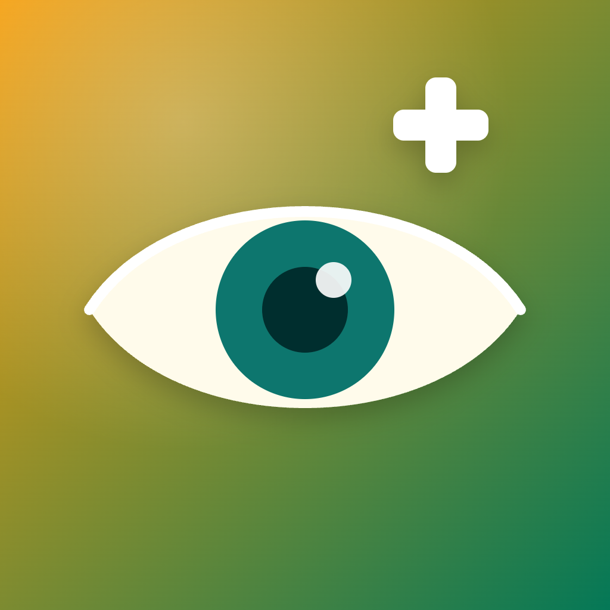
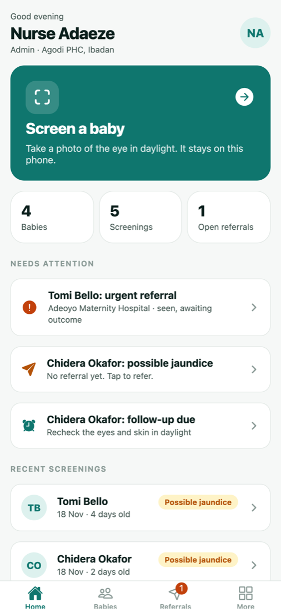
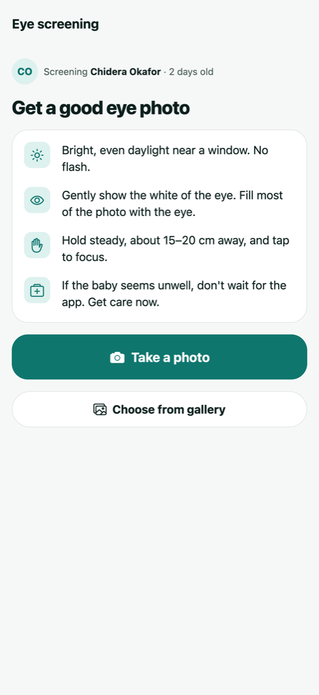
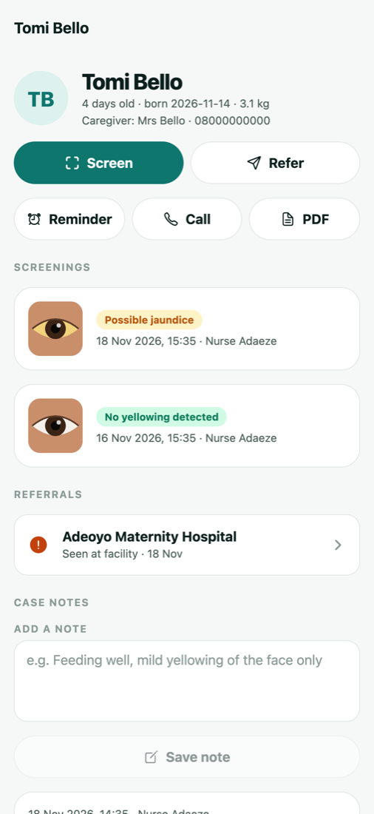
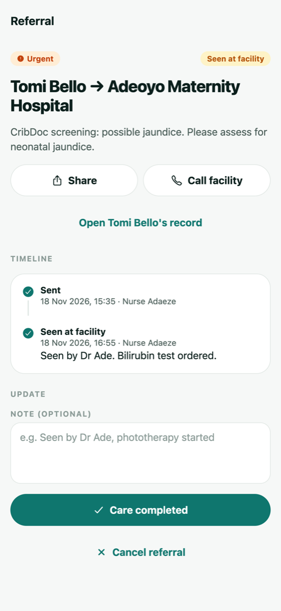

<p align="center">
  
</p>

<h1 align="center">CribDoc</h1>

<p align="center">
  <strong>Catch newborn jaundice early, even with no internet.</strong><br />
  On-device eye-photo screening, referrals that get followed up, and case management for care teams.
</p>

<p align="center">
  
  
  
  
  
  
</p>

<p align="center">
  
  
  
  
</p>

> **Status:** the app, the on-device pipeline and the native ONNX setup are done. The eye model is being trained on a new dataset; until it is installed and calibrated, CribDoc shows **no result at all**, never a made-up one. Screenshots use sample records and illustrated eyes.

---

## Why CribDoc

Neonatal jaundice is common and usually treatable when it's caught early, but many homes and primary health centres have no reliable internet and no bilirubin meter nearby. CribDoc puts a first check in a phone: take a photo of the baby's eye, get a screening result in about a second, and if it looks like jaundice, refer the baby and make sure the referral is followed through.

## Features

| | |
|---|---|
| **Eye-photo screening on the phone** | Guided capture (daylight, no flash, white of the eye visible), preview, then analysis with ONNX Runtime on the CPU. No upload, no account. |
| **Babies and case records** | Several babies per phone, each with age, birth weight, caregiver contact, every screening with its photo, referrals and dated case notes. |
| **Referrals that get followed up** | Create from a result (urgent is suggested for possible jaundice), share as text or call the facility, then track *Sent → Seen → Completed* with who updated it and notes. |
| **Roles** | *Parent*, *health worker* and *admin*, each seeing what they need. Several people can share a clinic phone and switch users; their names go on everything they do. |
| **Needs attention** | Home surfaces urgent open referrals, possible-jaundice results with no referral yet, and follow-ups that are due. |
| **Follow-up reminders** | Local notifications for rechecks; saved even if notifications are off. |
| **PDF case report** | One baby's screenings (with photos), referrals and notes, ready to share with a clinic. |
| **Danger signs** | When to go now, what jaundice is, and what not to do at home. |

## The on-device pipeline

`src/ml/pipeline.ts` (pure, tested) and `src/ml/screening.ts` (native glue):

1. **Shrink natively.** `expo-image-manipulator` resizes the photo to 640 px before it's decoded, so a 12 MP photo never reaches JavaScript.
2. **Find the sclera.** A YOLOv8 segmentation model (`assets/ml/cribdoc-eye.onnx`) outlines the white of the eye.
3. **Build the mask fast.** Mask prototypes are combined only inside each detection's box, not over the whole 160 × 160 plane.
4. **Measure yellowing.** Otsu's threshold drops shadows and lashes; the yellow index is the share of bright sclera pixels in the yellow hue band.
5. **Decide.** The index is compared with the calibrated threshold in `assets/ml/cribdoc-eye.json`. Too little visible sclera returns *Photo not clear enough* instead of a guess.

Speed details: the model session starts loading in the background when the app opens, and the model file is copied to app storage once rather than on every launch. Every result records how long it took.

The model's input/output format, plus scripts to export, calibrate and check a newly trained model, are in [`ml/`](ml/README.md).

## Tech

- **Expo SDK 58** (React Native 0.88, React 19.3), Expo Router with tabs, TypeScript (strict), React Compiler
- **ONNX Runtime** (`onnxruntime-react-native`) with a config plugin that links it and bundles the model on Android and iOS ([`plugins/withCribDocModel.js`](plugins/withCribDocModel.js)), plus a Gradle 9 compatibility patch applied on install
- `jpeg-js`, `expo-image-manipulator`, `expo-file-system`, `expo-print`, `expo-sharing`, `expo-notifications`
- **Jest** + React Native Testing Library

```
src/
  app/            screens: (tabs) home/babies/referrals/more, scan, baby/, referral/, reminders, team, model, learn, onboarding
  components/     UI kit
  data/           model.ts (types, roles, referral rules), store.ts (on-device state)
  ml/             pipeline.ts (maths), screening.ts (ONNX Runtime + photo prep)
  lib/            storage, photos, PDF report, notifications
plugins/          Expo config plugin for ONNX Runtime + the model
ml/               model contract, export / calibrate / check scripts
__tests__/        pipeline maths, rules, and real user flows
```

## Getting started

```bash
npm install                 # also applies patches/ via patch-package
npx expo start              # UI only: Expo Go and web can't run the model
```

To run the model you need a development build (ONNX Runtime is native code):

```bash
npx expo run:android        # or: npx expo run:ios
# or a shareable APK
npx eas-cli build --platform android --profile preview
```

### Tests

```bash
npm test                    # 29 tests
npx tsc --noEmit
npx expo lint
```

The tests cover the pipeline maths (letterboxing, the sclera mask, the yellow index, Otsu, the decision rule), roles and permissions, referral transitions, and real flows through the screens: onboarding, a scan with no model (explains why and saves nothing), the needs-attention list, referring a baby and tracking it to completion, parents not being able to update referrals, adding a team member and switching user, and case notes.

## Roadmap

- [ ] Train, calibrate and bundle the eye model (`ml/`)
- [ ] Clinical review of the copy and thresholds; validation study on held-out photos from different phones
- [ ] Encrypted on-device storage for records and photos
- [ ] Yorùbá, Hausa, Igbo and Pidgin
- [ ] Optional sync for care teams across devices

## Safety

CribDoc is a screening aid, not a medical device, and does not diagnose jaundice. A reassuring result must never delay assessment by a qualified health professional. Seek urgent care for any danger sign.

## Author

Built by **Olateju Olamide Emmanuel**, mobile developer & ML engineer.
[Portfolio](https://tejusportfolio.vercel.app) · [GitHub](https://github.com/tejHacks) · [LinkedIn](https://www.linkedin.com/in/olateju-olamide-22314a292/)

## License

MIT, see [LICENSE](LICENSE).
